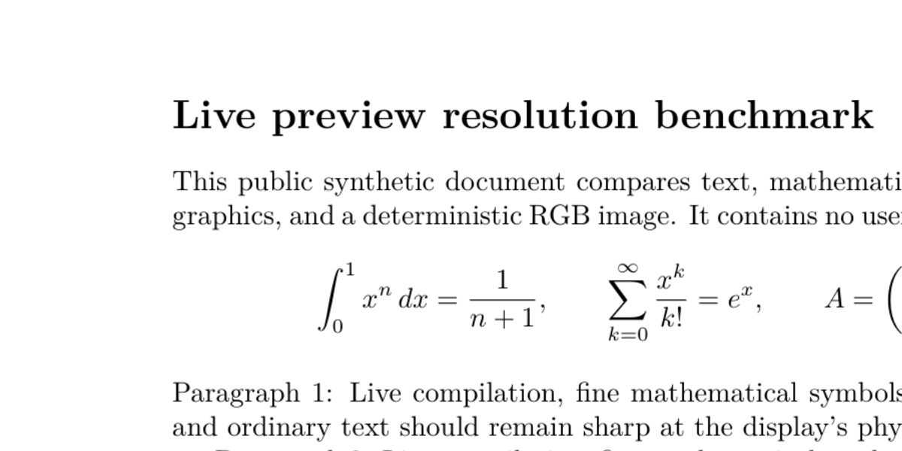
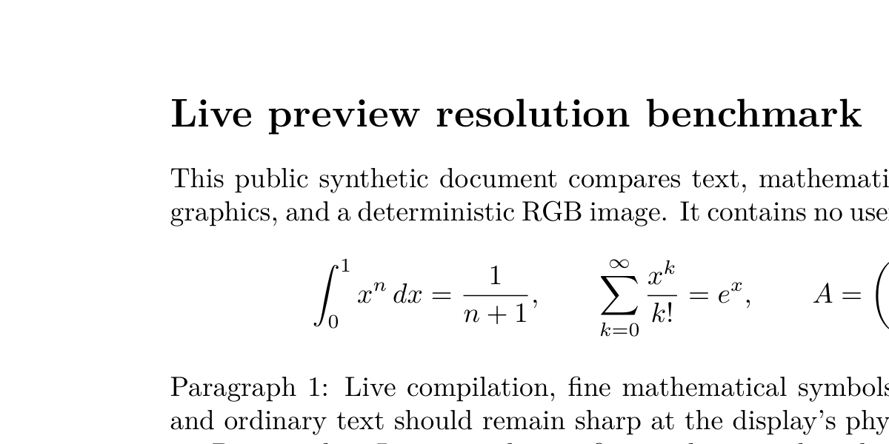

# Preview resolution and measured cost

2026-10-31 · Apple M1 Pro · macOS 15.7.9 arm64 · Qt 6.12.0.

The live viewer now opts into a **16,000,000-pixel ceiling**, and renders at the
requested physical-pixel width whenever that fits. The previous engine ceiling
was 4,000,000 pixels. The unconditional `0.999` raster-scale reduction is also
gone: even small previews previously lost a pixel or two and were resampled.

This is a ceiling, not a target. The client still requests
`round(displayedWidth * devicePixelRatio)`, once. A small preview costs the same
as before. Width requests remain limited to 4096 and output axes to 8192. At
extreme zoom an A4 page still hits the area limit: a 4096-pixel request produces
3363×4757 pixels. Viewport tiles are a possible future way to avoid both that
limit and rendering offscreen pixels.

## Sharpness

At a 2240-pixel request (for example, a 1120-logical-pixel-wide pane on a 2×
display), the same A4 page changed from **1681×2377 to 2240×3168** pixels. That is
about 1.78 times as many pixels, with no horizontal upsampling. These are crops
of the same public fixture at the same physical destination size; they are not
screenshots or a claim about the macOS compositor.

Before:



After:



## Timings

The Release Qt harness requests uncached pages from the engine, receives its
binary PNG, and waits for the real preview controller's asynchronous decode and
publication. These timings **exclude widget painting, screen presentation and
TeX compilation**. A precompiled three-page synthetic PDF isolates display-list
construction, raster/export, IPC and decode; it does not establish editing
latency or compiler speed. Pages contain text/math, colored vectors, and a
deliberately high-entropy RGB image. The image case stresses encoding/decoding
and is not representative of an ordinary text paper.

| Requested width / content | Before publication | After publication | Before raster | After raster |
| --- | ---: | ---: | --- | --- |
| 1200 / text and math | 14.8 ms | 14.3 ms | 1199×1696 | 1200×1698 |
| 2240 / text and math | 21.9 ms | 35.0 ms | 1681×2377 | 2240×3168 |
| 2240 / colored vectors | 39.5 ms | 63.6 ms | 1681×2377 | 2240×3168 |
| 2240 / RGB noise | 200.3 ms | 344.0 ms | 1681×2377 | 2240×3168 |
| 3200 / text and math | 21.8 ms | 59.5 ms | 1681×2377 | 3200×4526 |
| 3200 / RGB noise | 199.0 ms | 696.4 ms | 1681×2377 | 3200×4526 |

For the 2240-pixel text case, the native export component rose from **12.2 to
21.6 ms**, and the transferred PNG from **0.18 to 0.27 MiB**. The remaining
publication interval also includes native page work, transport, event-loop
polling and Qt decode; it must not be labelled pure decode time.

An 8-megapixel alternative took the same ~35 ms at width 2240 because it rendered
the same pixels. At width 3200 it stopped at 2378×3364 and took 38 ms for text;
the 16-megapixel ceiling delivered the requested width in 60 ms. The higher
ceiling buys detail when needed, with a real large-image/high-zoom cost.

Two warmups and seven measured samples were taken per content/width. Runs were
serial: before, 8 MP, 16 MP, before. No test or build workload ran alongside the
recorded comparison. Before values pool the fourteen samples from the two
bracketing runs; after values are medians of seven. Earlier exploratory runs
overlapped validation and were discarded. There are no timing assertions in CI.

## Memory

At width 2240, decoded text-page storage rose from **3.82 to 6.77 MiB** (the
engine's exact-grayscale PNG decodes to a grayscale image). Colored pages rose
from **15.24 to 27.07 MiB**. At width 3200 a colored page occupies 55.25 MiB.

After publishing the 2240-pixel text frame, sampled resident memory was roughly
**77 MiB Qt + 68 MiB native before**, and **104 MiB Qt + 105 MiB native after**.
The sequence had already rendered the other fixture pages. RSS includes font
stores, previous allocations and allocator retention, varies with OS residency,
and is neither the memory cost of one page nor a transient peak measurement.
The raw samples retain that distinction.

The native reusable-export cache stays at **32 MiB**. When a raw raster is too
large, it can cache encoded bytes alone, avoiding repeated rasterization while
keeping that limit. The current raster/patch base and in-flight frames remain
separate allocations. The Qt decoded-page LRU uses **32–64 MiB**, based on image
storage, rather than multiplying its limit by document length or zoom. Its
entry bound still applies. The total process footprint is larger than these
cache budgets; the preceding RSS figures include more than the LRU.

PNG frame validation and the encoder allow at most **16 MP / 64 MiB** for the
opt-in path, including a noisy RGB image that would exceed the old 16 MiB body
bound. SVG remains at 16 MiB. The engine advertises `maxPreviewPixels` and accepts
`-preview-max-pixels`; its legacy default stays 4 MP so existing extension
clients remain compatible. TeXstudio explicitly opts in. No format rebuild or
render-request/header/patch schema change is needed.

## Reproduction and data

[Raw samples, hashes and environment](measurements.json) include all 1200, 1800,
2240, 3200 and 4096-pixel cases. The fixture contains no paper or private content.
The engine frontend was compiled with `-O2`; the common Qt harness was Release.
The same client executable and fixture PDF were used for every run.

```sh
cmake -S src/texpresso -B build-raster-perf -DCMAKE_BUILD_TYPE=Release \
  -DTEXSTUDIO_TEXPRESSO_BENCHMARKS=ON -DTEXSTUDIO_TEXPRESSO_TESTS=OFF \
  -DCMAKE_PREFIX_PATH=/opt/homebrew
cmake --build build-raster-perf --target texpresso-raster-benchmark --parallel
python3 native/scripts/benchmark_preview_resolution.py \
  --benchmark build-raster-perf/texpresso-raster-benchmark \
  --before-engine native/.bundles/darwin-arm64-startup-anchor/bin/texpresso \
  --after-engine native/.bundles/darwin-arm64-retina/bin/texpresso \
  --output /tmp/texstudio-resolution-new-run
```

The output directory must not exist. The helper generates deterministic PNG
content and compiles the public fixture with installed XeLaTeX before starting
timings. Read-only `/bin/ps` access is needed for memory samples. On Linux adjust
the Qt prefix and engine paths; the measurements above are from macOS only.

Correctness coverage adds dimension/area checks over ordinary and extreme
aspect ratios, a lossless >16 MiB RGB PNG, CLI bounds, client wire limits,
Retina LRU eviction, and real 2240/3200-pixel page return/edit decoding.
